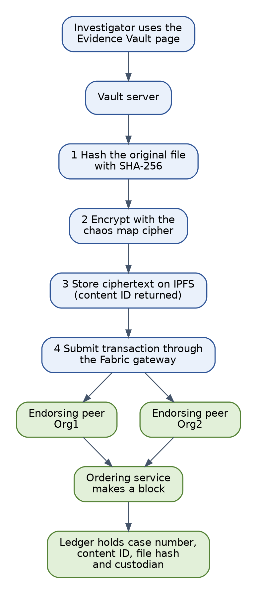

# Evidence Vault

A laboratory prototype that stores multimedia, CCTV and IoT sensor evidence so that **tampering is detected, the changed segment or reading is named, and the chain of custody can be checked by someone who does not trust the system**.

It was built for an Honours research project in Digital Forensics at the Namibia University of Science and Technology (2026), on the question of how a police service could preserve and authenticate digital evidence.

> **Research prototype.** It is not hardened, its chaos map ciphers have had no formal cryptanalysis, and it must not be used for real evidence. See [SECURITY.md](SECURITY.md).



## What it does

| Evidence | How it is protected |
|---|---|
| Any file | SHA-256 fingerprint, chaos map encryption, content addressed storage in IPFS, a record on a Hyperledger Fabric ledger |
| CCTV and multimedia recordings | Cut into byte segments, one Merkle tree, an encrypted manifest. A change is reported with its segment number, byte range and time window |
| IoT sensor data | Readings grouped in batches, each chained to the one before. A missing or replayed batch is refused by the chaincode |
| Custody | A hash linked trail of every handover that anyone can recompute without the chaincode |
| Storage | An on premise IPFS node plus an encrypted replica on a second node. Keys never leave the premises |
| Access | Two organisations endorse every write, and a read only verifier role can check evidence but not change it |

## Quick start (demo mode, about 15 minutes)

Demo mode runs the real chaincode logic against an in memory store, so you need no blockchain.

```
ipfs init
ipfs daemon                      # leave it running in one terminal
```

```
cd vault
npm install
node server.js --demo            # then open http://localhost:3000
```

```
node tests/objective3-tests.js   # in a second terminal, from the vault folder
```

You need Node.js 20 or newer and [Kubo](https://docs.ipfs.tech/install/command-line/). Install FFmpeg for the video tests. The full instructions, including a second IPFS node and a real Fabric network on Windows with WSL 2, are in [docs/SETUP.md](docs/SETUP.md).

## Documentation

| Document | Contents |
|---|---|
| [docs/SETUP.md](docs/SETUP.md) | Step by step setup for demo mode and for a real Fabric network, and what to do after a restart |
| [docs/TROUBLESHOOTING.md](docs/TROUBLESHOOTING.md) | Every problem met while building this, with its fix |
| [docs/ARCHITECTURE.md](docs/ARCHITECTURE.md) | Design, chaincode functions, custody chain, Merkle tree specification, ciphers, HTTP interface, settings |
| [docs/TESTING.md](docs/TESTING.md) | What each test checks, how to run it, and what to expect |
| [docs/RESULTS.md](docs/RESULTS.md) | The author's measurements from one complete run |

## Repository layout

```
chaincode/evidence-cc/    Fabric chaincode (JavaScript) and its 23 unit tests
fabric-scripts/           Deploy, roles, smoke test and restart scripts for the Fabric network
vault/                    Node.js server, browser page and test scripts
  lib/                    Chaos ciphers, Merkle trees, IPFS tiers, custody check, Fabric connection,
                          in memory ledger for demo mode
  tests/                  Functional tests, detection trial, benchmarks, cipher evaluation
docs/                     Guides and diagrams
results/                  Unedited output of the author's complete run
```

## Results at a glance

Measured on one laptop (Intel Core i7 8565U, 12 GB RAM) with generated evidence. Full tables in [docs/RESULTS.md](docs/RESULTS.md).

| Finding | Result |
|---|---|
| Functional tests | 27 of 27 passed (7 + 14 + 6), plus 23 chaincode unit tests |
| Tamper detection | 600 checks, every change detected and located, no false alarms |
| Ledger commit | About 2.1 s at every file size from 100 KB to 25 MB |
| 500 MB recording | Ingested and verified, server memory peaked at 345 MB |
| Sensor batching | 1000 readings anchored 95 to 520 times faster than one transaction per reading |
| Cost against a plain copy and hash | 30 to 62 times slower, the price of encryption, replication and a shared ledger |
| Original chaos map cipher | Repeats completely over a 20 MiB stream. The default perturbed cipher does not, at about one seventh of the speed |

## Limitations

The evidence was generated and a fixed test key was used. The Fabric network was a test network on one machine, and the cloud tier was a second node on the same machine, so its results show the logic and not internet latency. Reads are not logged and no alerts are raised. The ciphers have had statistical evaluation only. Court admissibility was not tested.

## Licence and citation

MIT licence, see [LICENSE](LICENSE). To cite the project, use [CITATION.cff](CITATION.cff) or GitHub's "Cite this repository" button.

The accompanying thesis is not part of this repository.
