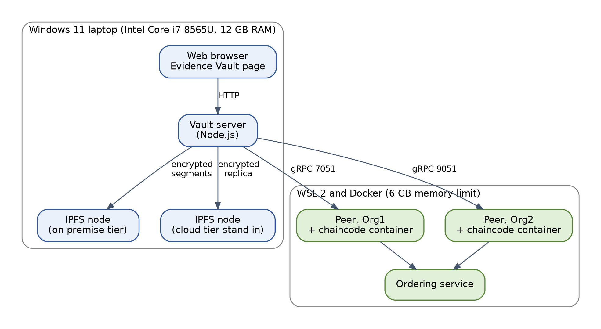
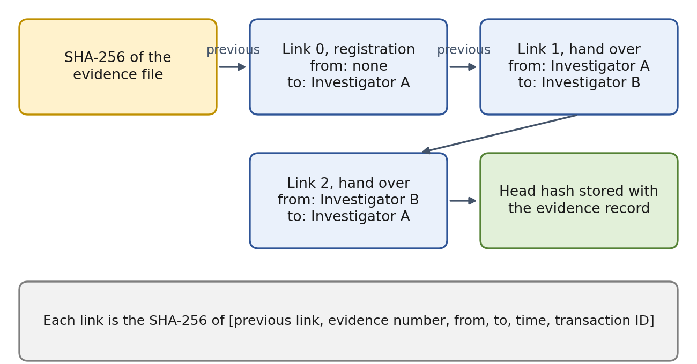
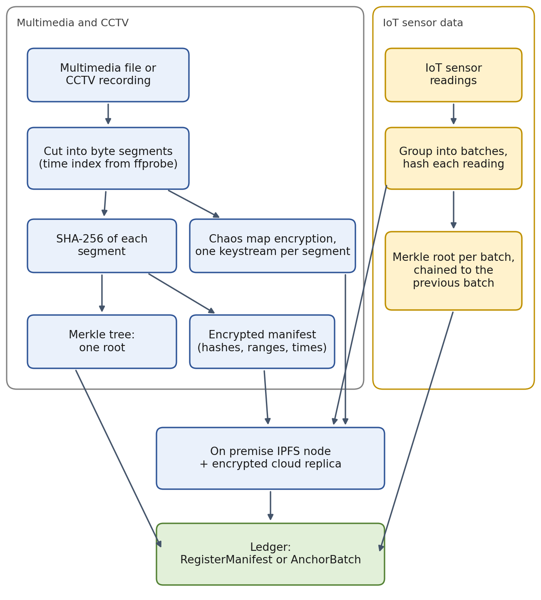
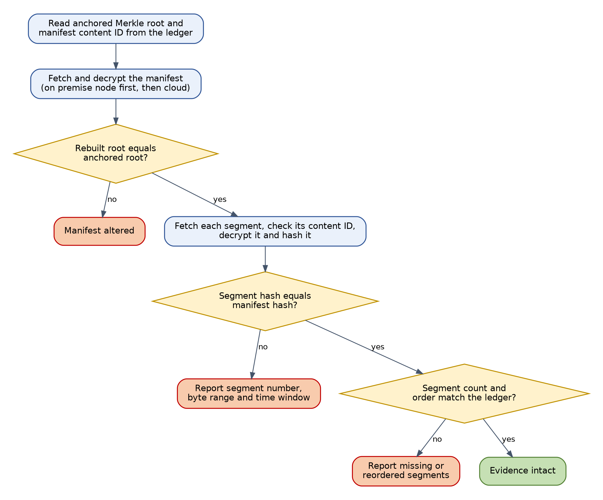

# Architecture

## The idea in one paragraph

Evidence files are large and sensitive, so they never go on the ledger. The vault server hashes the original file, encrypts it, and stores the ciphertext in IPFS, which addresses content by its hash. A small record goes on a Hyperledger Fabric ledger that two organisations must both endorse. The record holds the case number, the IPFS content identifier, the SHA-256 hash of the original file and the custodian. To check evidence later, the server reads the record, fetches the ciphertext, decrypts it and compares the hash. Any change to the file, the stored copy or the record breaks a comparison.

## Processes

| Process | Where it runs | Role |
|---|---|---|
| Browser page (`vault/index.html`) | Browser | Save, check, hand over and attack evidence. Works in a simulated mode inside the browser and in a live mode through the server |
| Vault server (`vault/server.js`) | Node.js | Hashing, encryption, segmenting, Merkle trees, IPFS and ledger calls, and the HTTP interface |
| IPFS node, on premise | Kubo, port 5001 | Holds every encrypted segment, manifest and batch |
| IPFS node, cloud tier | A second Kubo, port 5002 (`CLOUD_IPFS_API`) | Receives an encrypted replica. Reads fall back to it if the first node cannot answer |
| Fabric peers and orderer | Docker (through WSL on Windows) | Run the `evidence` chaincode and keep the ledger |
| `evidence` chaincode | In the peers | Roles, evidence records, custody chain, manifests, sensor batches |
| In memory ledger (`vault/lib/memchain.js`) | Node.js, demo mode | Runs the same chaincode code against an in memory store |

## Identities and roles

| Key in the API | Fabric identity | Role | May |
|---|---|---|---|
| `officerA` | Org1 Admin | Administrator | Grant roles, register, hand over, read |
| `officerB` | Org1 User1 | Investigator | Register, hand over, read. Also the gateway for sensor devices |
| `verifier` | Org2 Admin | Verifier | Read and check only |
| `outsider` | Org2 User1 | None | Refused for everything restricted |

Every write needs endorsement from both organisations (the default policy). Roles are held on the ledger and checked inside the chaincode.

## Chaincode

Two contract classes live in one chaincode package named `evidence`. Call the second one as `MediaContract:FunctionName`.

| Function | Who may call it | What it does |
|---|---|---|
| `InitLedger` | First caller, once | Makes the caller the administrator |
| `AddInvestigator`, `AddVerifier` | Administrator | Grant a role to an identity |
| `RegisterEvidence` | Administrator, investigator | Validates input, stores the record and the first custody link |
| `TransferCustody` | Current custodian | Hands custody to an authorised investigator, adds a custody link |
| `GetEvidence`, `GetAllEvidence`, `GetHistory`, `GetCustodyTrail` | Any role | Read records, ledger history and the custody chain |
| `WhoAmI`, `GetEvidenceCount` | Anyone | Identity and count |
| `MediaContract:RegisterManifest` | Administrator, investigator | Registers a recording with its Merkle root and segment count. Creates an ordinary evidence record, so custody works the same way |
| `MediaContract:RegisterDevice` | Administrator | Binds a sensor device to one gateway identity |
| `MediaContract:AnchorBatch` | The bound gateway | Accepts the next batch only in strict sequence |
| `MediaContract:GetManifest`, `GetBatch`, `GetBatchChain`, `LastBatch` | As above | Read manifests and batch records |

## Chain of custody

Each custody link is `SHA-256( JSON [ previous link, evidence number, from, to, time, transaction ID ] )`. The first link is chained to the SHA-256 hash of the evidence file. The latest link is stored on the record as `custodyHead`. `vault/lib/custody.js` recomputes the whole chain without using the chaincode's own answer, so anyone holding an exported trail can repeat the check.

## Large recordings and multimedia

1. The file is cut into fixed size byte segments of the untouched original (4 MiB by default). Cutting by bytes keeps the original exact, so the hash of the whole file can still be reproduced.
2. Each segment is hashed with SHA-256 and encrypted with its own keystream, then added to IPFS (and replicated to the cloud tier).
3. A Merkle tree over the segment hashes gives one root. Leaf = `SHA-256(0x00 || segment number as 8 bytes || segment hash)`. Node = `SHA-256(0x01 || left || right)`. The tree splits at the largest power of two below the count, as in RFC 6962, so no leaf is duplicated.
4. A manifest (JSON) lists the segment hashes, byte ranges, content identifiers and time windows, and records the hash of the whole file. It is encrypted and stored in IPFS. For video, the time window of each segment comes from the packet positions reported by `ffprobe`. Without `ffprobe`, windows are estimated in proportion to size.
5. `RegisterManifest` puts the manifest's content identifier, the Merkle root, the file hash and the segment count on the ledger.

Verification rebuilds the Merkle root from the manifest, compares it with the ledger, then fetches, decrypts and hashes every segment. A bad segment is reported with its number, byte range and time window. The comparison of a file someone holds against the ledger (`/api/media/check-file`) also classifies the change as altered, deleted, inserted, reordered, truncated or extended.

## IoT sensor data

Readings are grouped into batches. The hash of a reading is `SHA-256(JSON [device, seq, t, kind, value])`. Each batch has a Merkle root over its reading hashes. `AnchorBatch` computes `batchHash = SHA-256(JSON [previous batch hash, Merkle root, batch index, device ID])`, starting from 64 zeros, and refuses a batch whose index is not exactly one more than the last. A gap or a replay is therefore refused by the chaincode itself. Batch files (readings and their hashes) are encrypted and stored in IPFS.

## Encryption

Two chaos map keystream ciphers are in `vault/lib/chaos.js`. Both XOR the data with a keystream, so the same call encrypts and decrypts. Select one with `CHAOS_MODE`.

| Mode | How it works | Notes |
|---|---|---|
| `perturbed` (default) | The logistic map `x -> 3.99 x (1 - x)`, with the state nudged every eight steps by a small amount taken from SHA-256 of 256 bit key material and a counter | No short cycle, 256 bit key material. About seven times slower than `basic` on the test laptop |
| `basic` | The plain logistic map seeded with 52 bits derived from SHA-256 | In double precision every seed falls onto one cycle of 6,623,920 states, so one stream longer than about 14 MiB repeats. Per segment seeds keep each stream short |

Key material is derived from one master secret and a label: `file` for single files, the segment number for segments, `manifest`, and `batch:<device>:<index>`. A keystream cipher protects confidentiality only. Integrity comes from SHA-256 and the Merkle tree.

## HTTP interface

The server listens on `127.0.0.1:3000` (set `PORT` to change it). Send `X-Acct` with `officerA`, `officerB`, `verifier` or `outsider`, and `X-Key` with the session key.

| Method and path | Purpose |
|---|---|
| `GET /api/status` | Readiness of IPFS, the ledger and the accounts |
| `GET /api/records`, `/api/ledger`, `/api/custody` | Records, ledger events, custody trail (`X-Id`) |
| `POST /api/save` | Save a file as evidence (headers `X-Case`, `X-Name`, `X-Mime`) |
| `POST /api/check-file`, `/api/check-vault` | Compare a file you hold, or the stored copy, with the ledger |
| `POST /api/transfer` | Hand custody to the other investigator |
| `GET /api/retrieve`, `/api/tampered` | Download the original after a check, or a copy with one bit flipped for testing |
| `POST /api/media/ingest` | Ingest a recording by path on the server's disk (JSON: `path`, `type`, `caseId`, `segmentSize`) |
| `POST /api/media/upload` | Ingest a recording sent as the request body (streamed to disk) |
| `POST /api/media/verify`, `/api/media/check-file` | Verify the vault copy, or check a file you hold, segment by segment |
| `POST /api/iot/simulate`, `/api/iot/verify` | Generate and anchor sensor batches, verify a device's whole sequence |
| `GET /api/iot/export`, `POST /api/iot/check-batch` | Export a decrypted batch, check an edited batch file |
| `POST /api/attack`, `/api/media/attack` | Demonstration attacks that show how tampering is caught |
| `POST /api/iot/raw-anchor`, `/api/tiers/outage` | Test hooks: submit a raw batch, and simulate an on premise outage |

## Settings

| Variable | Default | Meaning |
|---|---|---|
| `PORT` | `3000` | Port of the vault server |
| `IPFS_API` | `http://127.0.0.1:5001/api/v0` | On premise IPFS API |
| `CLOUD_IPFS_API` | (unset) | Cloud tier API. Unset means no replication |
| `CHAOS_MODE` | `perturbed` | `perturbed` or `basic` |
| `VAULT_GC_EVERY` | `4` | Request a memory collection every this many segments. `0` switches it off |
| `FABRIC_CRYPTO`, `WSL_DISTRO`, `WSL_USER` | see `docs/SETUP.md` | Where the Fabric certificates are |
| `FABRIC_CHANNEL`, `FABRIC_CHAINCODE` | `mychannel`, `evidence` | Channel and chaincode names |
