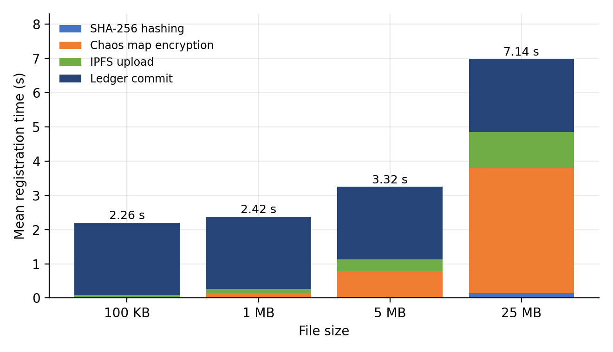
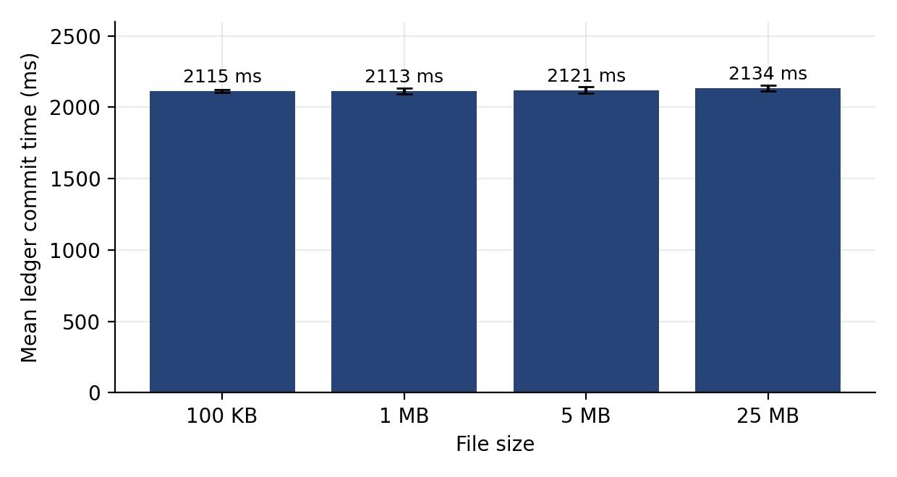
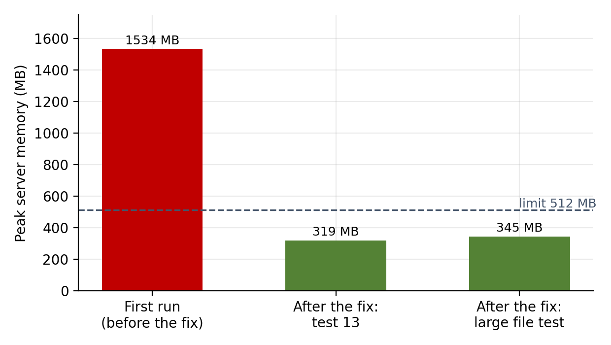
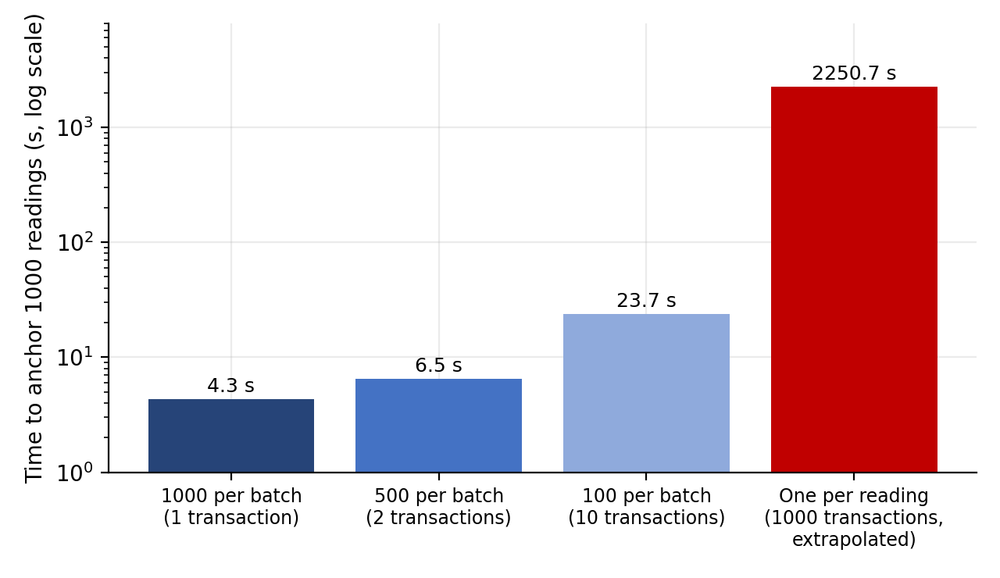
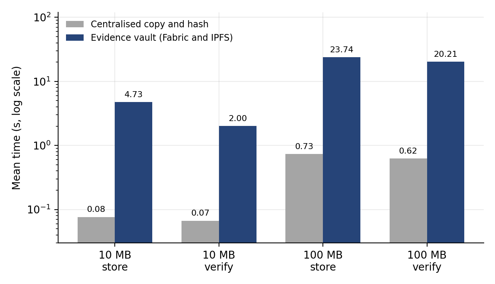
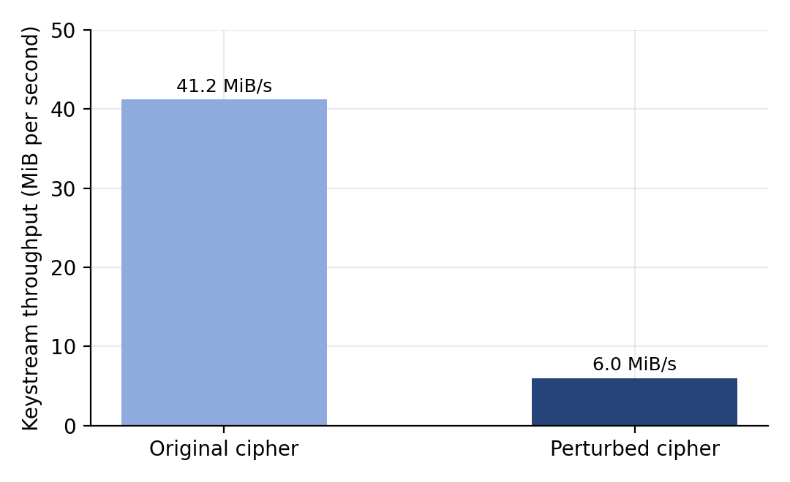

# Measured results

These are the author's measurements from one complete run on one laptop: Windows 11 Pro, Intel Core i7 8565U at 1.80 GHz, 12 GB RAM (WSL limited to 6 GB), Docker 29.8.2, Hyperledger Fabric 2.5.16 test network with two peer organisations, Kubo 0.43.1 with two nodes, Node.js 24.18.0. The evidence was generated, not real. Times are in milliseconds unless stated, shown as mean with standard deviation in brackets.

The unedited console output is in `results/final_run_output.md`. Absolute timings will differ on other hardware. The shape of the results is what carries over: the ledger commit does not depend on file size, and encryption is the largest cost on large files.

## Test outcomes

| Suite | Result |
|---|---|
| Objective 3 functional tests | 7 of 7 passed |
| Objective 4 functional tests | 14 of 14 passed |
| Objective 5 custody tests | 6 of 6 passed |
| Tamper detection trial | 600 checks: every change detected and located, no false alarms |
| Chaincode unit tests | 23 of 23 passed |

## Registration and verification time, by file size

| Step | 100 KB | 1 MB | 5 MB | 25 MB |
|---|---|---|---|---|
| SHA-256 hashing | 0.6 (0.1) | 6.3 (1.1) | 30.9 (3.2) | 147.2 (6.1) |
| Chaos map encryption | 16.2 (6.8) | 149.8 (5.7) | 756.8 (57.3) | 3649.9 (38.4) |
| IPFS upload | 72.9 (15.1) | 106.8 (17.3) | 341.2 (103.5) | 1057.1 (123.4) |
| Ledger commit | 2114.9 (10.0) | 2112.6 (19.6) | 2121.0 (23.6) | 2134.0 (21.0) |
| Registration total | 2258.2 (55.8) | 2419.2 (31.6) | 3315.1 (140.7) | 7137.6 (122.2) |
| Verification total | 69.5 (9.3) | 256.0 (28.5) | 1030.1 (77.8) | 4638.0 (28.7) |

Registration includes a role check by the chaincode and the transfer to the server, so it is slightly larger than the sum of its steps.

## Ingestion and verification of 10 MB and 100 MB recordings

| Step | 10 MB (10 runs) | 100 MB (5 runs) |
|---|---|---|
| SHA-256 hashing | 120.6 (3.0) | 1197.4 (39.8) |
| Chaos map encryption | 1415.3 (23.4) | 14388.8 (416.7) |
| IPFS write, on premise | 261.2 (55.0) | 2866.1 (1388.1) |
| Replication to the cloud node | 250.4 (41.2) | 2418.5 (1184.4) |
| Manifest | 67.7 (8.7) | 54.1 (6.6) |
| Ledger commit | 2137.1 (12.6) | 2105.6 (12.6) |
| Ingestion total | 4728.9 (117.7) | 23735.3 (2977.9) |
| Verification total | 2002.8 (56.2) | 20205.5 (288.2) |

Replication is the copy to the second IPFS node.

## A 500 MB recording

| Measure | Result |
|---|---|
| Segments | 125 segments of 4 MiB |
| Ingestion time | 115.2 s (122 s in the test suite run) |
| Of which hashing, encryption, IPFS, replication, ledger | 6.0 s, 69.9 s, 19.1 s, 16.6 s, 2.2 s |
| Verification time | 100.0 s, verified |
| Server memory, total | 279 MB before, 345 MB at the peak |
| Server memory, JavaScript heap and buffers | Heap 27 to 83 MB, buffers 7 to 56 MB |

The first run of this test failed: the server peaked at 1534 MB because every segment was copied several times. Reusing one buffer and collecting memory every four segments fixed it.

## Anchoring 1000 sensor readings

| Batch size | Transactions | Mean time (SD) | Speed up over one per reading |
|---|---|---|---|
| 1000 | 1 | 4.33 (0.01) | 520 |
| 500 | 2 | 6.48 (0.03) | 347 |
| 100 | 10 | 23.67 (0.03) | 95 |
| 1 (extrapolated from 20 readings) | 1000 | 2250.7 | 1 |

## Against a centralised baseline

| Operation | Baseline | Evidence vault | Vault compared with baseline |
|---|---|---|---|
| Store 10 MB | 76.4 (5.4) | 4728.9 (117.7) | 62 times |
| Verify 10 MB | 66.6 (3.3) | 2002.8 (56.2) | 30 times |
| Store 100 MB | 731.4 (41.7) | 23735.3 (2977.9) | 32 times |
| Verify 100 MB | 623.2 (36.2) | 20205.5 (288.2) | 32 times |

The baseline copies the file and stores its SHA-256 hash. It has no encryption, no replication and no ledger.

## Storage tiers

| Measure | Result |
|---|---|
| Verify a 10 MB recording, on premise node (5 runs) | 2033.2 ms (SD 49.5) |
| Verify a 10 MB recording, cloud node only (5 runs) | 2015.0 ms (SD 33.0) |
| Write of 10 MB, on premise and replica to cloud | 261.2 ms and 250.4 ms |
| Write of 100 MB, on premise and replica to cloud | 2866.1 ms and 2418.5 ms |
| Failover test | All segments read from the cloud node, none from the on premise node |

Both nodes ran on the same laptop, so this shows the replication and failover logic, not internet latency.

## Tamper detection trial

| Evidence type | Detection | Located correctly | False alarms | Time per check |
|---|---|---|---|---|
| CCTV footage | 100.0% (96.3 to 100.0%) | 100.0% (96.3 to 100.0%) | 0.0% (0.0 to 3.7%) | 77 ms |
| Photograph | 100.0% (96.3 to 100.0%) | 100.0% (96.3 to 100.0%) | 0.0% (0.0 to 3.7%) | 58 ms |
| IoT sensor batch | 100.0% (96.3 to 100.0%) | 100.0% (96.3 to 100.0%) | 0.0% (0.0 to 3.7%) | 82 ms |
| All kinds together | 100.0% (98.7 to 100.0%) | Not applicable | 0.0% (0.0 to 1.3%) | Not applicable |

Figures in brackets are 95 percent Wilson intervals. A perfect rate is expected because SHA-256 changes completely when any bit changes.

## The two chaos map ciphers

| Measure | Original cipher | Perturbed cipher |
|---|---|---|
| Keystream throughput | 41.2 MiB per second | 6.0 MiB per second |
| Entropy of 4 MiB of keystream | 7.99996 bits per byte | 7.99995 bits per byte |
| Chi square p value | 0.462 | 0.256 |
| Monobit p value | 0.993 | 0.827 |
| Runs p value | 0.970 | 0.268 |
| Serial correlation | -0.00104 | 0.00063 |
| Compression ratio | 1.0003 | 1.0003 |
| Bits changed by changing the last digit of the key | 50.00% | 50.03% |
| Bits wrong after decrypting with a wrong key | 50.00% | 49.95% |
| Ciphertext bits changed by flipping one plaintext bit | 1 | 1 |
| Bytes equal between two 4 MiB segments at the same position | 0.39% | 0.39% |
| 256 KiB segment pairs that share keystream | 0 of 190 | 0 of 190 |
| Bytes in a 20 MiB single stream equal to the byte one cycle earlier | 100.00% | 0.39% |

The original cipher repeats over a long stream because, in double precision, the logistic map falls onto a cycle of 6,623,920 states. The perturbed cipher is the default.

